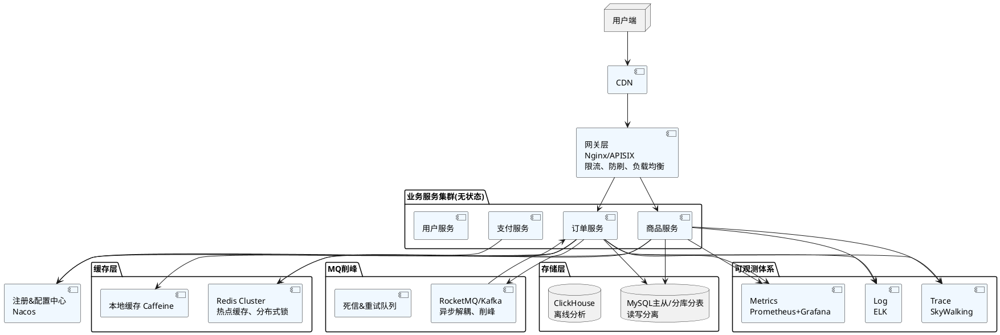

# 合集：分布式高并发高可用&稳定性全套（场景题+PlantUML+大促方案+简历话术+CAP/BASE务实版）
> 全部偏向实战，拒绝纯八股，面试、述职、写方案都能用

---
## 一、场景面试题（题干+考察点+参考答案，务实版）
### 1. 秒杀系统怎么设计？
**考察点**：流量分层、削峰、防超卖、一致性、降级兜底
**回答**
1. 接入层：CDN + 网关限流（总QPS、单用户限流），验证码/滑动验证打散瞬时流量，拦截恶意请求。
2. 前置缓存：商品库存预热到Redis，**库存预扣**；Redis做分布式锁，防止并发超卖。
3. 削峰：Redis预扣成功后，丢消息到MQ，下游消费异步落库、创建订单；主链路不直接操作DB。
4. 防超卖：Redis预扣是第一层，DB最终扣减做二次校验；库存扣减用数据库行锁/乐观锁，禁止查出库存再业务判断。
5. 兜底：Redis挂了直接降级秒杀，提示活动拥挤；MQ堆积阈值告警，堆积过多直接拒绝新请求；超时未支付，定时任务回滚库存。
6. 限制：秒杀是短时间热点，不做强一致，优先保证**不超卖、核心可用**；允许少量用户排队、延迟结果。
> 坑：不要同步直写DB；不要无限重试；不要把全部库存放一个Redis key（热点key）。

### 2. 突然出现热点Key，大量请求打Redis，Redis CPU打满，怎么办？
**考察点**：缓存击穿、热点治理、流量隔离
**回答**
- 止血：立刻做**热点key本地缓存（Caffeine）**，网关层对该商品UID做路由隔离，流量打散到独立Redis分片；临时关闭过期淘汰。
- 根治：热点key拆分（比如`goods_1001_0~goods_1001_9`）、永不过期、提前预热；热点业务独立集群，不和普通业务混部。
- 预案：热点自动发现（监控key访问频次），自动推送本地缓存；熔断，Redis异常时直接返回兜底静态页。
> 区分：击穿是key过期瞬间；热点是key一直存在、访问量极高。

### 3. MySQL主库宕机，怎么止血、恢复？
**考察点**：存储高可用、故障切换、数据一致性、回滚
**回答**
1. 止血：自动故障转移（MGR/哨兵）选新主；网关/DAO层切写流量到新主；如果自动切换失败，人工介入。
2. 读流量：读从库不受影响，注意**新主同步延迟**，短时间内允许读到旧数据（业务接受最终一致）。
3. 校验：核对binlog，确认数据无丢失；检查半同步配置，降低丢数据概率。
4. 复盘：排查宕机根因（慢SQL、大事务、磁盘满、内核bug）；优化SQL、拆分大事务。
> 禁忌：不要在主库宕机时疯狂重试写请求；不要跨机房强同步，延迟太高。

### 4. 下游第三方接口（支付、短信）超时，把你整个服务拖垮？
**考察点**：服务保护、舱壁、熔断降级
**回答**
1. 隔离：单独线程池（舱壁）调用第三方，第三方慢不会占满业务线程池。
2. 超时：设置合理短超时，不无限等待；重试只允许幂等接口，带指数退避、最大重试次数。
3. 熔断：连续失败率达到阈值，熔断一段时间，直接走降级逻辑（比如排队、稍后再试、备用通道）。
4. 兜底：短信走备用服务商；支付引导用户稍后重试，记录单据异步补偿。
5. 监控：单独大盘看第三方RT、错误率，提前预警。

### 5. MQ消息大量堆积，怎么处理？
**考察点**：消息队列稳定性、削峰边界
**回答**
1. 先定位：生产太快？消费太慢？消费报错卡主？
2. 止血：
   - 消费卡主：修复消费异常、死信隔离坏消息；
   - 消费能力不足：扩容消费者实例；
   - 生产洪峰：上游限流，低优先级消息直接丢弃/降级；
3. 风险控制：堆积持续上涨会打爆磁盘，设置磁盘水位告警；
4. 长期：拆分topic，优先级队列；消息批量消费；优化消费逻辑，减少单条耗时。
> 重点：MQ是缓冲，不是无限蓄水池，堆积不等于正常。

### 6. 线上变更发布之后，P0故障，怎么处理？
**考察点**：故障SOP、变更治理、稳定性流程
**回答**
1. 第一原则：**先止血，后定位**，优先回滚，而不是在线debug。
2. 动作：关闭流量、切备用集群、回滚版本；同步通知值班、升级负责人。
3. 止血之后，拉链路、日志、指标定位根因；记录时间线。
4. 复盘：变更评审缺失、灰度流量不够、缺少监控、缺少回滚预案；新增检查项。
> 行业共识：80%故障来自变更，灰度、蓝绿、变更冻结是核心防线。

### 7. 怎么理解CAP、BASE？业务上怎么取舍？
**回答见文末单独章节**

### 8. 什么是多活？同城双活和异地多活差别？适合什么业务？
**回答**
同城双活：同一城市两个机房，数据同步延迟低，故障切换快；适合支付、订单核心链路；代价是机房成本。
异地多活：跨城市，容灾更强，同步延迟大，存在数据冲突；适合用户量大、需要地域容灾；订单、资产类业务做异地多活成本极高，需要ID路由、冲突方案。
取舍：绝大多数业务，同城双活足够；异地多活不要盲目上。

### 9. 怎么压测？压测要注意什么？
**回答**
1. 压测模型：模仿真实流量，带热点、长尾、不同接口比例，不是均匀QPS。
2. 压测环境：隔离环境，禁止压测生产；压测数据隔离，避免污染。
3. 观测指标：QPS、RT、错误率、CPU、内存、连接池、缓存命中率、DB慢查询。
4. 验证：不只测上限，还要验证限流、熔断、降级是否生效。
5. 常态化压测 + 大促专项压测；压测后输出容量水位。

### 10. 雪崩是什么？怎么层层防御？
**回答**
雪崩：一个下游变慢/挂掉，上游大量请求堆积、重试，逐级向上传导，整条链路瘫痪。
防御四层：
1. 超时：每个调用都有超时；
2. 舱壁：线程池隔离；
3. 熔断：连续失败直接短路；
4. 限流降级：入口挡住流量，保护核心。

---
## 二、PlantUML 架构图代码（可直接复制到支持PlantUML的工具渲染）

渲染出来就是：用户→CDN→网关→微服务集群，配套缓存、MQ、数据库、可观测底座。

---
## 三、大促稳定性保障方案（可直接改一改当文档模板）
# 【大促稳定性保障方案】
## 1. 目标
核心链路SLA：99.99%；P0故障MTTR<5min；不发生资损、大面积雪崩。
核心链路：商品浏览、下单、支付；非核心：评价、推荐、消息推送。

## 2. 阶段划分
### 阶段1：准备期（提前1~2个月）
1. 链路梳理：画出核心链路，梳理所有依赖（内部服务、第三方、中间件）
2. 容量评估：基于历史峰值、活动预估倍数，计算QPS、连接数、存储、带宽水位
3. 压测：多轮压测，单链路压测、全链路压测；验证限流、熔断、降级预案
4. 资源扩容：K8s预扩容、数据库从库扩容、Redis分片扩容；核心业务独占资源池
5. 依赖治理：第三方SLA确认、降级方案对齐；慢SQL、大事务提前治理

### 阶段2：预案&演练（提前2周）
1. 故障预案清单：网关打满、Redis宕机、MySQL主库宕机、MQ堆积、第三方超时、热点事件
2. 混沌演练：随机杀实例、注入网络延迟、CPU高负载，验证熔断降级是否生效
3. 降级开关提前上线：配置中心一键开关，可快速关闭非核心功能
4. 变更冻结窗口：大促前3天至大促结束，**禁止核心链路代码、SQL、中间件参数变更**，紧急bug走特殊审批

### 阶段3：值班保障（大促当天）
1. 值班小组：业务、后端、DBA、中间件、运维，值班群，分级升级机制
2. 大盘值守：核心SLA大盘、错误率、RT、MQ堆积、DB连接、缓存命中率
3. 限流保护：网关动态限流，热点单独隔离；优先保下单支付

### 阶段4：复盘期（大促结束后1~3天）
1. 全链路复盘：所有告警、毛刺、小故障统一汇总
2. 输出Postmortem：时间线、现象、根因、影响、止血动作、长期改进项
3. 沉淀到常态化稳定性体系，更新预案

## 3. 红线规则
- 不允许大促期间上线新功能；
- 不允许临时修改索引、大批量DDL；
- 所有预案必须可一键执行，有回滚；
- 资损类故障最高优先级。

## 4. 兜底降级示例
- 评价、推荐、商品详情评论：直接关闭
- 消息推送：降频、丢弃非重要消息
- 活动玩法：次要玩法下线，保下单

---
## 四、简历精炼话术（3个版本，从轻到重，避免浮夸）
> 版本1（稳妥标准版，大部分后端）
负责在线业务分布式系统稳定性建设，架构采用CDN+网关流量治理、微服务无状态化、多级缓存、MQ异步削峰、MySQL读写分离分库分表；落地熔断、舱壁、限流降级防护；搭建Metrics/Trace/Log可观测体系，常态化压测、灰度发布、故障复盘机制，保障核心业务SLA 99.99%，支撑大促高并发流量。曾处理热点key、MQ堆积、第三方依赖超时等线上故障，沉淀对应的隔离与熔断预案。

> 版本2（偏架构/稳定性负责人）
主导高并发业务稳定性体系建设，设计同城双活架构，负责容量规划、全链路压测、混沌演练、变更管控；统一建设流量治理、服务治理、缓存治理规范；推动故障复盘闭环，降低P0/P1故障发生率；对资损、雪崩风险建立专项防护。

> 版本3（简短，简历简介栏）
擅长分布式高并发系统设计、链路稳定性治理；熟悉网关、缓存、消息队列、MySQL分库分表等高可用方案；具备大促保障、故障应急、容量压测实战经验。

---
## 五、CAP / BASE / 最终一致性（务实版，拒绝空谈）
### CAP
> 理论：分布式系统，**一致性C、可用性A、分区容错P，三者不能同时满足**
- 分区P：网络分区，分布式系统**一定会出现，P是必须的**。
所以现实选择只有两个：
1. CP：牺牲可用性，优先保证数据一致（Zookeeper、分布式锁场景），分区时不可用
2. AP：牺牲强一致，优先保证可用（绝大多数业务：商品、订单、评论，BASE）
✅ 重点：**不是三选二随便挑，P是分布式的固有前提**。

### BASE
- Basically Available（基本可用）：故障时，核心可用，次要功能降级
- Soft state（软状态）：数据中间状态，允许一段时间不一致
- Eventually consistent（最终一致性）：一段时间后，数据自动对齐
> 绝大多数互联网业务都是BASE，接受最终一致，换取高可用、高吞吐。

### 什么时候用强一致？
资产、转账、扣钱，这类资损场景，才考虑强一致；强一致代价极高，链路慢、吞吐低、故障容易不可用。
> 一句话口诀：**给钱强一致，看商品、下单、通知走最终一致**。

---
## 六、额外补充：容易踩的架构误区（面试加分）
1. 上来就异地多活、强一致分布式事务，业务流量很小，复杂度爆炸；
2. 缓存当成DB，强一致场景用缓存，造成资损；
3. 重试没有限制，下游抖动直接放大成雪崩；
4. 备份从来不演练，出事恢复失败；
5. 告警泛滥，几百条告警刷屏，真正故障被淹没；
6. 微服务拆得过细，调用链超长，RT上涨、故障点变多；
7. 把MQ当成无限缓冲池，不设置堆积水位、不做丢弃策略。

---
如果你还想要：
1. 一版【故障复盘模板（Postmortem）】
2. 或者 分布式事务（本地消息表、事务消息、TCC、SAGA）务实对比
告诉我就行。